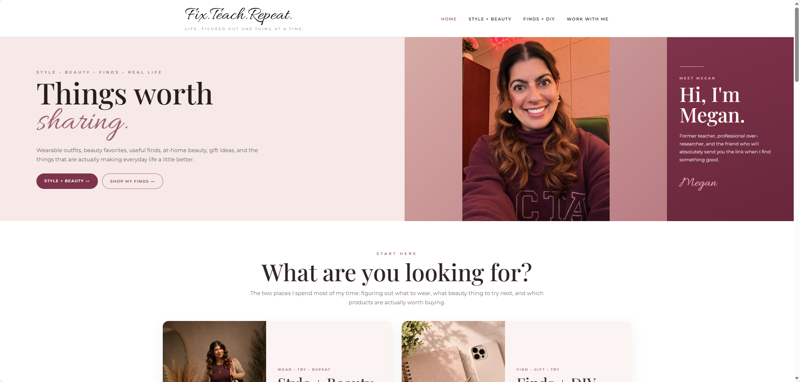
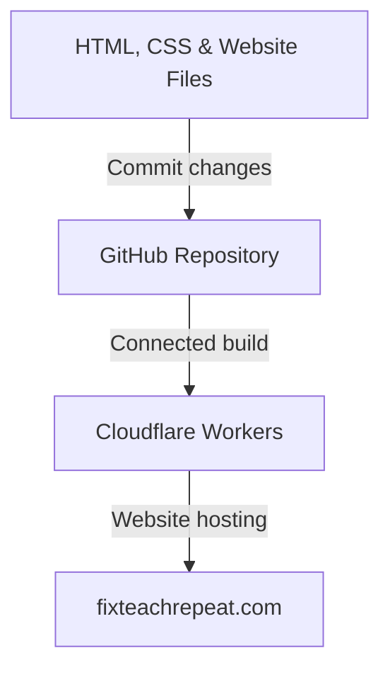

# Personal Website Development & Cloudflare Deployment

**Live Website:** https://fixteachrepeat.com  
**Project Status:** Active Development & Maintenance  
**Project Type:** Independent Technical Portfolio Project

## Project Overview

This project documents the development, deployment, and ongoing maintenance of my personal website, fix.teach.repeat.

I use this project to gain practical experience with cloud hosting, web technologies, GitHub version control, deployment workflows, troubleshooting, and technical documentation.

The website is developed using AI-assisted coding workflows, with hands-on involvement in implementation, configuration, testing, and troubleshooting.

## Website Preview

**Live Website:** https://fixteachrepeat.com

## Technical Architecture

**Deployment workflow:** Website files are maintained in GitHub. Changes committed to the production branch trigger Cloudflare builds. Successful deployments are verified on the live website.

## Technologies & Tools

| Technology | Application |
|---|---|
| HTML & CSS | Website structure, content, and styling |
| GitHub | Source code storage, version tracking, and branch management |
| Cloudflare Workers | Website hosting and deployment |
| Cloudflare DNS | Custom domain configuration |
| ChatGPT | AI-assisted code generation, revisions, and troubleshooting |
| Notepad | Editing and saving website files |
| GitHub Integration | Connecting source code changes to Cloudflare builds |

## Project Architecture

The website uses the following deployment workflow:

1. Website files are maintained in a GitHub repository.
2. The repository is connected to Cloudflare Workers.
3. The `main` branch is configured as the production branch.
4. Cloudflare builds the project when changes are committed.
5. Successful deployments make updated website content available through the hosting platform.
6. The live website is reviewed to verify functionality.

A separate `development` branch is available for development work.

## Technical Challenges & Troubleshooting

### Cloudflare Build Configuration

**Challenge:** During the transition from manual deployments to GitHub-connected deployments, a Cloudflare build failed.

**Investigation:** Reviewed GitHub build status, Cloudflare deployment logs, and Workers build settings.

**Resolution:** Updated the project's `wrangler.jsonc` configuration and deployment settings. Subsequent builds completed successfully.

**Skills demonstrated:**
- Reading deployment logs
- Investigating build failures
- Working with JSON-based configuration
- Troubleshooting cloud deployment workflows
- Validating successful builds

### Transition to GitHub Version Control

**Challenge:** The original workflow involved generating code with ChatGPT, saving HTML files using Notepad, transferring files through USB storage, and manually uploading files to Cloudflare.

**Improvement:** Organized the website files into a GitHub repository and connected the repository to Cloudflare.

**Result:** Established a source-controlled workflow with GitHub-connected builds, reducing reliance on manual file uploads.

## Testing & Validation

Following deployment changes, I verify website functionality by reviewing:

- Homepage accessibility
- Website navigation
- Images and styling
- Internal page links
- Successful Cloudflare build status
- Live website behavior after updates

## Skills Demonstrated

- Technical troubleshooting and problem-solving
- GitHub repository management
- Cloud hosting fundamentals
- Web deployment configuration
- HTML and CSS fundamentals
- Build-log investigation
- Technical documentation
- AI-assisted development workflows

## Future Improvements

- Continue refining the GitHub development workflow
- Document additional troubleshooting scenarios
- Improve website performance and accessibility
- Expand testing documentation
- Add project screenshots and architecture diagrams

---

**Professional Development Note**

This is an independently managed personal learning and development project. AI-assisted tools are used to help generate and revise code, while I manage website configuration, deployment workflows, testing, and troubleshooting.

The project supports my continued professional development in IT support, application troubleshooting, cloud technologies, and technical operations.
